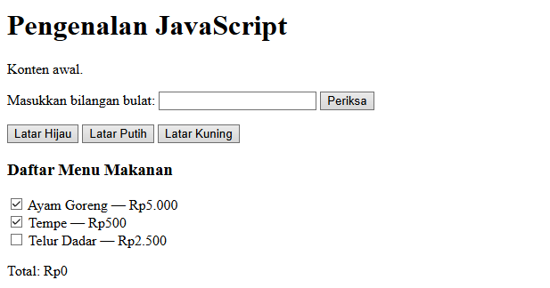
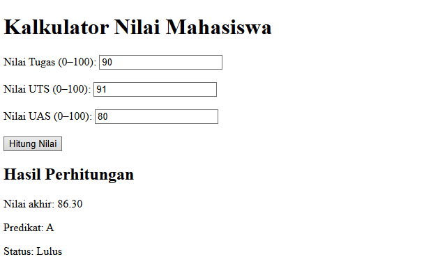

# Praktikum JavaScript — Latihan 1: Menampilkan Output Hello World

## Tujuan Praktikum

Tujuan praktikum ini adalah memahami dasar penggunaan JavaScript dalam halaman web. Selain itu, praktikum ini bertujuan mempelajari cara menampilkan informasi pada halaman HTML dan Console browser menggunakan JavaScript.

## Dasar Teori

JavaScript merupakan bahasa pemrograman yang digunakan untuk mengatur perilaku dan interaksi pada halaman web. JavaScript dapat digunakan untuk mengubah isi elemen HTML, menampilkan pesan, melakukan perhitungan, dan membuat halaman web menjadi lebih interaktif.

Pada latihan pertama ini, JavaScript digunakan untuk menampilkan teks Hello World pada halaman HTML menggunakan textContent dan pada Console browser menggunakan console.log().

## Langkah-Langkah Praktikum

1. Membuat folder praktikum dengan nama Lab5Web.

2. Membuat file index.html untuk menyusun struktur halaman web.

3. Membuat file script.js untuk menuliskan perintah JavaScript.

4. Menghubungkan file JavaScript dengan HTML menggunakan elemen script.

5. Menambahkan perintah JavaScript untuk menampilkan teks Hello World pada halaman dan Console.

6. Menyimpan seluruh file yang telah dibuat.

7. Membuka file index.html menggunakan browser.

8. Memeriksa tampilan halaman dan membuka Console melalui menu Inspect atau Periksa pada browser.
## 4. Screenshot
Tambahkan screenshot hasil kalkulator yang sudah dijalankan di browser pada bagian ini.

# Praktikum JavaScript — Kalkulator

## 1. Tujuan
Membuat aplikasi kalkulator sederhana menggunakan HTML dan JavaScript untuk melakukan operasi aritmatika.

## 2. Langkah-Langkah
1. Membuat file `index.html` sebagai struktur halaman kalkulator.
2. Membuat tampilan kalkulator dengan tombol angka dan operator matematika.
3. Menambahkan JavaScript untuk memproses input dan menghitung hasil.
4. Menguji fungsi penjumlahan, pengurangan, perkalian, dan pembagian.
5. Menjalankan program melalui browser dan memastikan kalkulator berfungsi dengan baik.

## 3. Hasil Praktikum
Kalkulator dapat menerima input angka, melakukan operasi matematika dasar, dan menampilkan hasil perhitungan pada layar.

## 4. Screenshot
Tambahkan screenshot hasil kalkulator yang sudah dijalankan di browser pada bagian ini.

